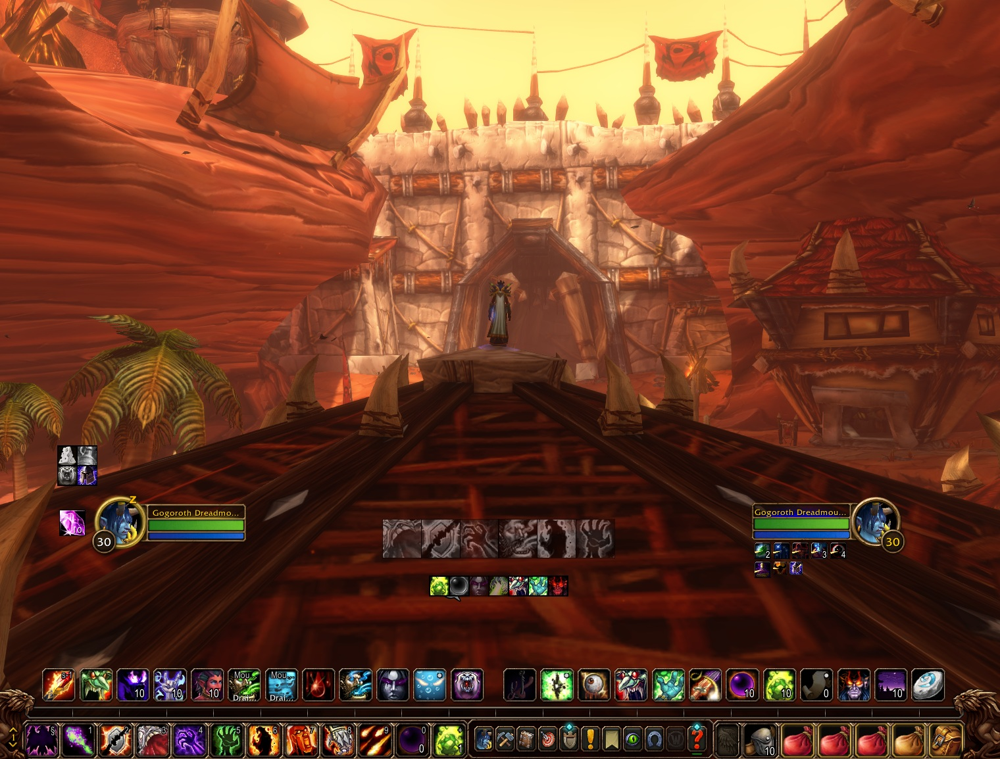
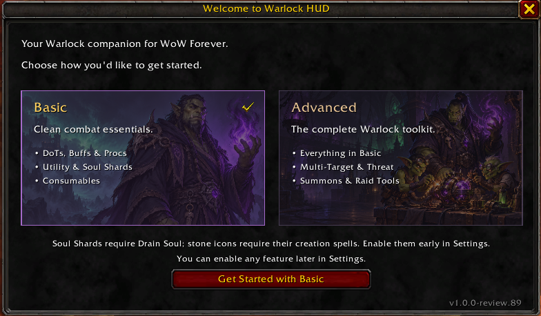
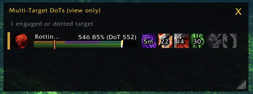
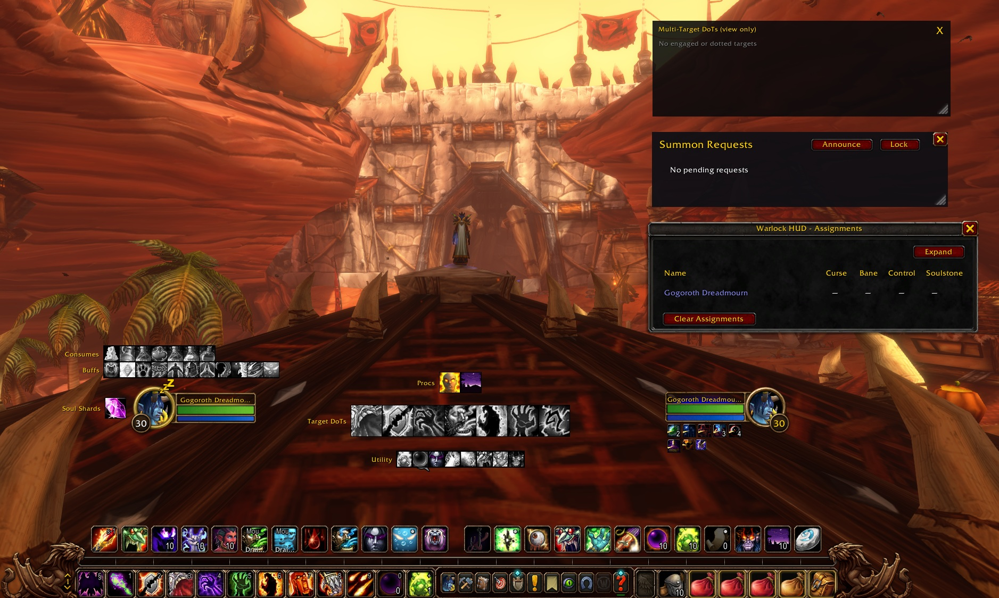
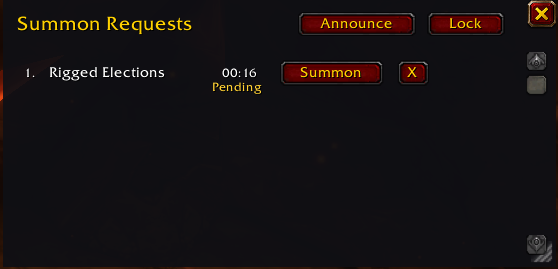
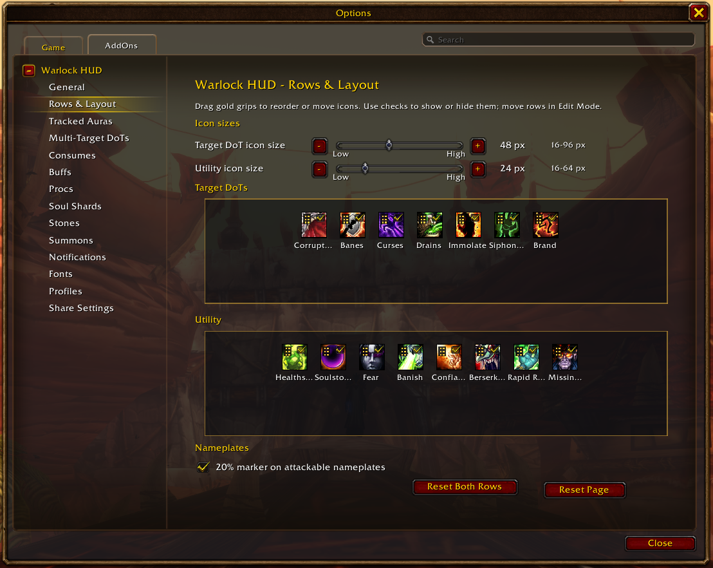

# Warlock HUD

**Your Warlock. Your HUD. Your raid, organized.**

Warlock HUD is a customizable combat HUD and utility toolkit for **World of Warcraft: Forever**. Keep your DoTs, cooldowns, buffs, consumables, and Soul Shards in view, while coordinating Warlock assignments and summon requests with your group.

It started as a personal addon and has grown through suggestions, testing, and feedback from fellow Warlocks.

**Less time managing your UI. More time playing your Warlock.**

## Get Started

Choose a starting preset in the welcome screen:

- **Basic** sets up the core HUD: DoTs, buffs, procs, cooldowns, consumables, and Soul Shards.
- **Advanced** adds Multi-Target DoTs, damage estimates, threat indicators, and summon tools.

Presets are starting points. You can change individual features afterward. Applying a preset updates the selected profile while keeping other profiles and Edit Mode positions.

## Multi-Target DoTs

**Spread the DoTs. Keep track of the chaos.**

Track up to **16 enemies** in a compact, customizable window:

- Track Corruption, Immolate, Siphon Life, Banes, and Demonic Brand with native icons, timers, and stacks where available.
- See enemy health and raid markers, with optional 20% and 35% health markers.
- Compare estimated remaining DoT damage with enemy health, with a visual warning when the estimate is lethal.
- Monitor your group's threat with LOW, MED, and HIGH indicators when the game exposes that information.
- Keep last-seen targets in view along with their estimated DoT state.
- Adjust the window size, scale, layout, transparency, and icon visibility.

Damage predictions are estimates, not guaranteed kills. WoW: Forever restricts some combat information, which can limit target discovery and estimates. The Multi-Target window is view-only; select enemies through normal game controls.

## Combat HUD

### Spells, cooldowns, and procs

- Track Corruption, Immolate, Siphon Life, Banes, Curses, Drains, and Demonic Brand.
- Keep cooldowns, racial abilities, pet abilities, and important procs in sight when available to your character.
- Show castbar tick markers for Drain spells, Rain of Fire, and Wrack.
- Get optional warnings when you cast a lower-rank spell while a higher rank is known.

### Buffs and consumables

- Track Demon Armor, Soul Link, each Demonic Sacrifice effect, and group buffs.
- Keep Well Fed, flasks, elixirs, weapon oils, Firestones, Spellstones, and mana-regeneration effects visible.
- Choose which reminders to show when supported buffs or consumes are missing.
- Use native countdowns wherever the client makes them available.

### Demons and Soul Shards

- Get a reminder when your demon is missing and a customizable flashing alert when your pet reaches 35% health or less.
- Check known and missing grimoires while visiting demon trainers.
- Track Soul Shards with configurable reserve, low-count, and overflow warnings.

## Raid Assignments

Coordinate Warlocks without juggling spreadsheets or raid chat:

- Assign Curses and Banes across your group.
- Assign Fear or Banish to raid-marked targets.
- Set Soulstone responsibilities.
- Synchronize assignments with other Warlock HUD users, announce them to your group, and highlight casts that don’t match your assignment.

## Summon Request Queue

**No more hunting through raid chat for “123”!**

Collect requests from party, raid, instance chat, and eligible group-member whispers. Review them in a movable queue with waiting timers, summon buttons, and pending indicators. Requests can clear automatically when players arrive nearby. Keywords, request sources, and group announcements are configurable.

Summoning still requires your interaction.

## Healthstones and Soulstones

- Track completed Healthstone trades and review who you’ve supplied.
- Optionally place a Healthstone into an empty trade with a group member. You must accept the trade yourself.
- Track an assigned Soulstone recipient and show its status when the aura is confirmed. Optional reminders can flag expiry or uncertain loss.

A completed Healthstone trade records that a stone was supplied; it can’t confirm the recipient still has it.

## Make It Yours

- Move, resize, and reorder HUD elements; customize icon sizes, fonts, visibility, and colors.
- Choose which spells, buffs, procs, and consumes to track.
- Scale the Multi-Target, Summon, and Assignment windows independently.
- Create profiles for different playstyles and specializations, switch profiles with dual spec, and export or import settings to share.

Open settings with **`/whud`** or **`/whub`**. Use Edit Mode and the built-in HUD demo to arrange your layout before combat.

## Built for WoW: Forever

Warlock HUD is designed specifically for **World of Warcraft: Forever (1.60.1)**. It uses Blizzard-native aura and cooldown rendering where supported and respects the game’s protected combat API restrictions. Some information may be unavailable or estimated during combat.

## Feedback and Community

Have an idea or found a bug? Leave a CurseForge comment or [open an issue on GitHub](https://github.com/data-lock/warlock_hud/issues). Warlock HUD is open source under the **Apache 2.0 license**.

[View the source code and releases on GitHub](https://github.com/data-lock/warlock_hud)

### Thank You!

A huge thank you to my guildmates in **Tabula Rasa [EU]** for helping test and improve Warlock HUD, especially **Tiny** and **Wheat**.

Thanks also to **stevegeoffmcgeofforington**, **GamaKatsu**, **Drugnanov**, **devast**, and everyone who has shared ideas, bug reports, and testing along the way.

Special acknowledgement to the developer of [DoesItDie](https://www.curseforge.com/wow/addons/does-it-die), whose work with Forever’s protected health values helped inspire Warlock HUD’s lethal DoT indicator.

**See you in Forever!**
