# Warlock HUD

A configurable HUD for Warlocks in **World of Warcraft: Forever beta**. It keeps
target effects, cooldowns, buffs, procs, and Soul Shards visible without opening
other panels.

### HUD in play

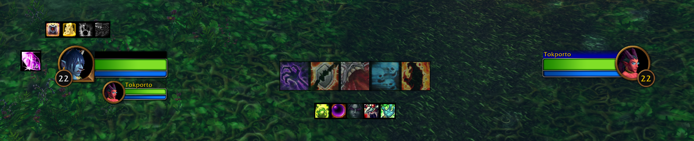

The live HUD shows only slots that are enabled and relevant to your character.
Target DoTs and buffs use their normal in-game colors and countdowns.

### All bars demo

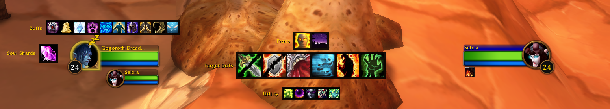

The demo labels **Consumes**, **Buffs**, **Procs**, **Target DoTs**, **Utility**, and **Soul
Shards** at their on-screen positions. It shows inactive and disabled icon slots
so you can see the full layout before choosing what to track. Open it from
**General → Demo all HUD bars** and close it with **End HUD demo**.

## Features

| Display | What it tracks |
| --- | --- |
| Main row | Corruption, Immolate, Siphon Life, Banes, Curses, and Drain spells. Banes, Curses, and Drains each share an icon slot. Active target effects show a countdown, including milliseconds. |
| Multi-Target DoTs (opt-in review) | Eight fixed nameplate rows with secure target buttons and native slots for your Corruption, Immolate, Siphon Life, and Banes. Empty rows show a waiting label; enable enemy nameplates with V. Outside combat, drag the title to move or the lower-right grip to resize. X closes the window during combat too. The window is disabled by default while combat targeting is verified in Forever. |
| Cooldown row | Healthstone, Soulstone, Fear, Conflagrate when learned, available racial abilities, and an optional flashing Sense Demons reminder when no demon or active Demonic Sacrifice is confirmed. Conflagrate shows its cooldown and pulses while your Immolate is active on the current target. |
| Consumes row | Well Fed plus optional Flask of Supreme Power, Arcane Elixir family, Shadow Power, Greater Firepower, Mageblood family, and Wizard Oil family trackers. Aura effects use native countdowns; Wizard Oil reads temporary weapon-enchant state without a HUD countdown. Each category has its own tracking and missing-reminder choice. The row has its own position, icon size, visibility, and color settings. |
| Buff row | Demon Armor / Demon Skin, Fortitude, Mark or Gift of the Wild, Intellect, Spirit, Kings, Salvation, Thorns, Demonic Sacrifice, Soul Link, and Unending Breath. Active buffs show colored icons with native countdowns when available; a setting reverses active and missing colors. Soul Link reminds when known, a demon is present, and its buff is confirmed missing. Thorns follows the same Druid-aware missing-buff reminder and active-buff formatting as Mark of the Wild. Unending Breath appears at the right end only while active. Visible buffs pack left to right. |
| Proc row | Power Infusion and Nightfall appear only while active, with a pulsing glow and countdown. |
| Soul Shards | A separate icon near the Player Frame shows your shard count. It flashes red at or below the low warning threshold (default 4), or yellow at or above the high threshold (default 18) or when shards occupy regular bags alongside an equipped Soul Bag. Each click destroys one shard from a regular bag, stopping when those bags are clear or your configured minimum remains. The default minimum is 8. Shards cannot be destroyed in combat. |
| Nameplates | A copper tick marks 20% health on attackable enemies' health bars. |
| Stones | A Soulstone recipient label centered below the Utility row only while the aura is confirmed active; details and a Healthstone distribution list are on the Stones settings page. |

Main row icons fade when there is no attackable target and turn red when the target
is out of range. Demon Armor / Demon Skin and Well Fed have missing-buff reminders.
The Buffs row keeps its left edge where you placed it as icons appear or disappear.
The HUD checks known spells and talents when deciding which icons to show.
On Tracked Auras, the Target DoT color toggle reverses the main row's active
and missing colors. The default is colored when active and grey when missing.
The Buffs page has its own color toggle. Missing-buff reminders still pulse red.
General has separate out-of-combat visibility switches for Target DoTs, Utility,
Consumes, Buffs, Procs, and Soul Shards. Hidden rows appear in combat and Edit Mode.
The Sharing page exports or imports selected profile sections as a copyable code.
Import previews the selected sections and asks for confirmation. The About page
can reset addon settings to defaults after confirmation.

### Known Forever beta issue: Soul Link below level 30

Extra talent points can make Soul Link castable before level 30. At level 25,
casting it consumed mana but applied no detectable buff to the player or pet,
with both a Voidwalker and a Succubus tested. The HUD therefore continues to
flash the missing Soul Link reminder. Active Soul Link behavior still needs an
in-game check at level 30; the addon should clear the reminder when the aura
actually appears.

Drain Life, Drain Mana, and Drain Soul show four interior tick markers on the
native player castbar while channeling. With a wand equipped, Shift+Right-click
a living enemy in the game world to target it and start Shoot. Ordinary
right-click keeps its usual behavior. `/whwand` reports the wand binding state.

After training, the addon warns in your chat window when a direct spell button
on an action bar uses a lower rank than the highest rank you know. It checks
again when your spells or action buttons change, and warns after every
successful lower-rank cast from a macro or the spellbook too.
The addon also remembers the spells and ranks of each demon you summon. At a
demon trainer's merchant window, grimoires already known by the relevant demon
show a red outline around their icons. Missing grimoires that are available
show green. A lower unlearned rank shows yellow when a higher usable rank is
also for sale. Grimoires for a pet that has not been scanned show grey when you
meet their level requirement. The tooltip
also explains known or unscanned status. Summon each demon once to build its
record. Records are saved per character.

The addon can announce Ritual of Summoning, a Soulstone cast, and a completed
Healthstone trade. Soulstone announcements go to party, raid, or instance chat
when grouped. Summon and trade notices can be sent to group chat or shown only
in your own chat window.

The **Summons** page configures the summon request queue. A current group member
can type `123`, `sum`, or `summ` by default in party, raid, instance chat, or a
whisper to open the separate queue window. Each row shows its wait time, a
Summon button, and an X to remove the request. The window can be moved, resized,
locked, or opened with `/whub summonqueue`. **Announce** invites requests in the
current group channel. A request stays queued after clicking Summon and clears
when the player arrives nearby. The summon and availability announcements show
your current Soul Shard count when the client provides it. **Preview 15 requests**
on the Summons page, or `/whub summonqueue demo`, opens a sample list for layout
checks and screenshots without sending chat or casting a summon.

The **General** settings page has **Demo all HUD bars**, which temporarily
overlays every icon slot at its on-screen HUD position, including disabled or
inactive buffs and procs. Each bar is labeled. Use **End HUD demo** to close it. The demo does not
change live aura tracking.

Warlock HUD runs by default on Warlocks and can be turned on or off per character
under **General**. The **Stones** page controls Soulstone status, Healthstone
distribution tracking, and optional automatic placement in an empty trade with
a current group member. You must press Accept yourself. A supplied entry means
a completed trade was recorded; it does not establish current possession.
Soulstone details appear on the Stones page only when a safe aura observation
confirms the buff is active. Countdowns may be stale during combat.
`/whub stones` lists supplied players. `/whub trace` opens a copyable debug
window with Trade, Soulstone, and Summon recording buttons.
The trace window also has an Assignments recording button and a Sync State
button for investigating group assignment messages on each client.

## Install

Place the files in this folder, keeping the folder name **`Warlock_Hud`** so it
matches `Warlock_Hud.toc`:

```text
World of Warcraft/_classic_beta_/Interface/AddOns/Warlock_Hud/
```

Enable **Warlock HUD** in the game's AddOns list, then enter the game or use
`/reload` after updating the files. There is no build step.
If you use `/reload` during combat, the HUD waits until combat ends before it
loads, because its native aura frames cannot be built safely in combat.

For a packaged download, use the ZIP attached to the latest GitHub Release.
It already contains the `Warlock_Hud` folder. Pushes to `main` also produce a
downloadable ZIP in the repository's Actions artifacts.

## Configure

Open the AddOns settings or type **`/whub`** (also **`/whud`**). Settings include
icon-size sliders with one-pixel step buttons, icon visibility, drag-to-reorder controls, notification choices,
Soul Shard minimum and warning thresholds, and profiles. Move each row and the Soul Shards icon in Edit
Mode; they snap to the grid. Profiles save the layout and can switch with your
active talent spec. The Profiles page validates names as you type and confirms
deletion of a profile.

Settings save as soon as they change. Layout changes update the HUD immediately
when the client allows a rebuild; otherwise the HUD updates after combat or can
be retried from the settings footer when safe.
Row and page reset actions restore the current profile's settings while keeping
its Edit Mode positions. Page resets ask for confirmation.

### Settings pages

The screenshots below show the available controls. **About** shows the loaded
addon and interface versions.

<details>
<summary>General</summary>

Enable Warlock HUD for this character and start the temporary on-screen demo
of every HUD bar. Choose whether each HUD row shows out of combat.

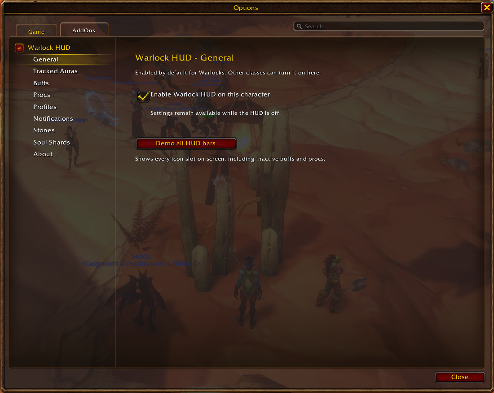

</details>

<details>
<summary>Rows & Layout</summary>

Set Target DoT and Utility icon sizes, reorder or hide slots, and toggle the
nameplate 20% marker.

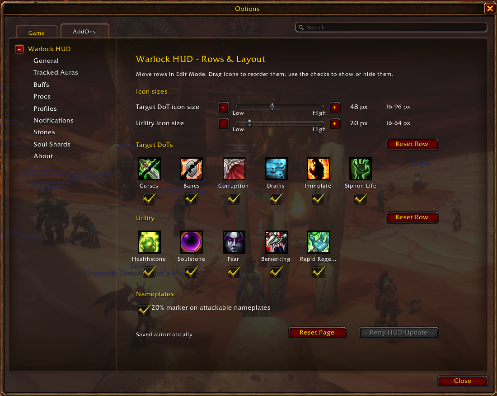

</details>

<details>
<summary>Tracked Auras</summary>

Choose eligible Corruption, Immolate, Siphon Life, Bane, Curse, Drain, and Fear
auras. Set whether active Target DoTs appear in color or grey.

Use **Group Assignments** to open a movable, resizable window with a Curse, Bane,
Fear/Banish raid marker, and Soulstone target choice for each Warlock in your group, or yourself while
solo. `/whud assignments` opens
the same window. Drag the lower-right corner to resize it, or press **Compact**
for a roster-sized list of names and assignment icons. Press **Expand** to edit
the choices again. Group assignments survive `/reload` for the current roster;
solo login starts with assignments unset. Group assignments clear when the
group disbands. **Clear Assignments** resets Curse, Bane, Fear/Banish, and Soulstone choices
for every Warlock shown. Multiple Warlocks may choose the same Soulstone target.
Anyone using the addon can assign spells. The chosen Curse or Bane appears as
your idle HUD image and sets its range check. A different
successful Curse or Bane cast gives a short local warning. The window never
casts spells. The Announce button shows its party, raid, or instance destination
and sends the current assignments there only when clicked. You can also use
`/whud announceassignments`.

Choose one raid marker, such as **Star**, for a Warlock's Fear/Banish target.
Compact view shows the marker. This records who handles a marked target; it
does not place the raid marker for you.

When your assigned Soulstone target is confirmed missing the buff and your
Soulstone is ready, its Utility icon pulses red. An unknown aura state does not
trigger the reminder.

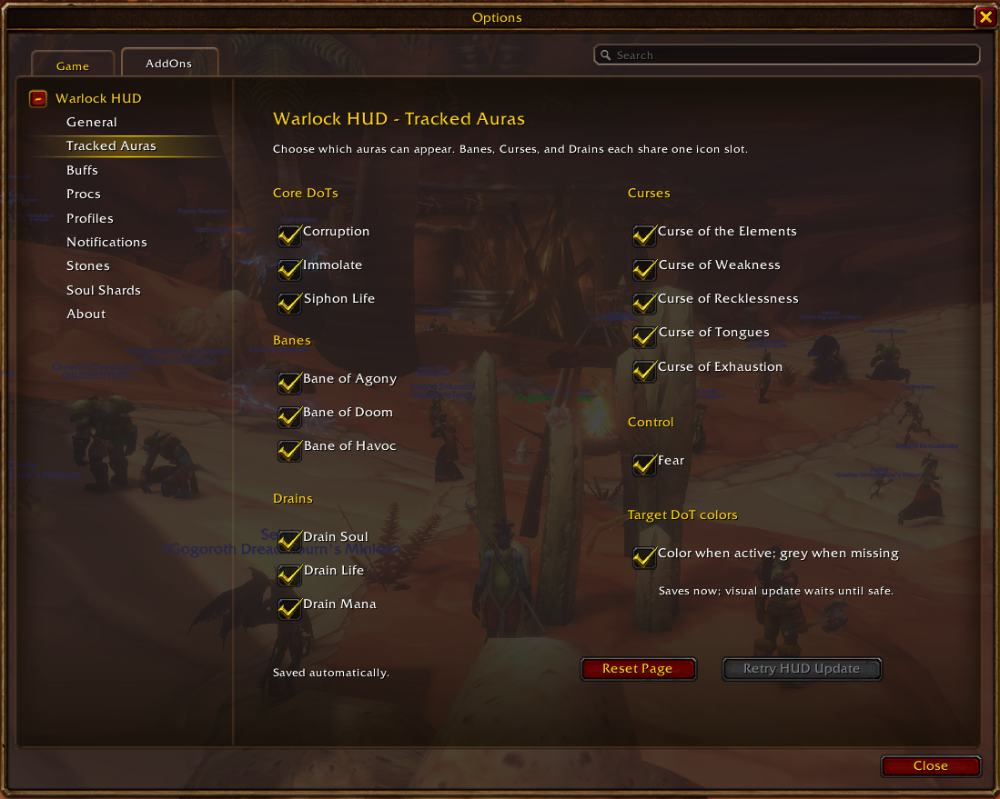

### Group Assignments

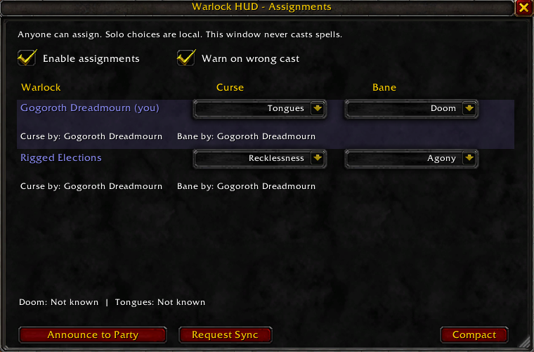

The compact view keeps the roster and assigned spell icons visible during play.

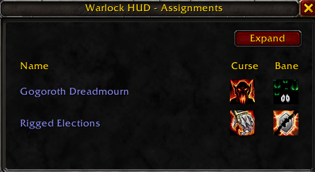

A wrong cast highlights its HUD slot until the assigned spell is cast, the
target changes, or the assignment changes.

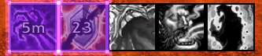

</details>

<details>
<summary>Buffs</summary>

Size, reorder, or hide buff slots. Choose active versus missing icon colors.
The page also explains group buff reminders.

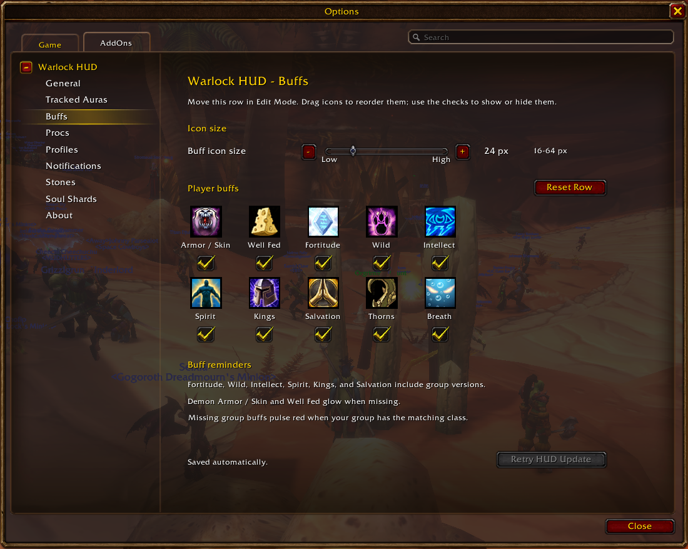

</details>

<details>
<summary>Procs</summary>

Size and arrange the Power Infusion and Nightfall slots. These icons appear in
the live HUD only while their procs are active.

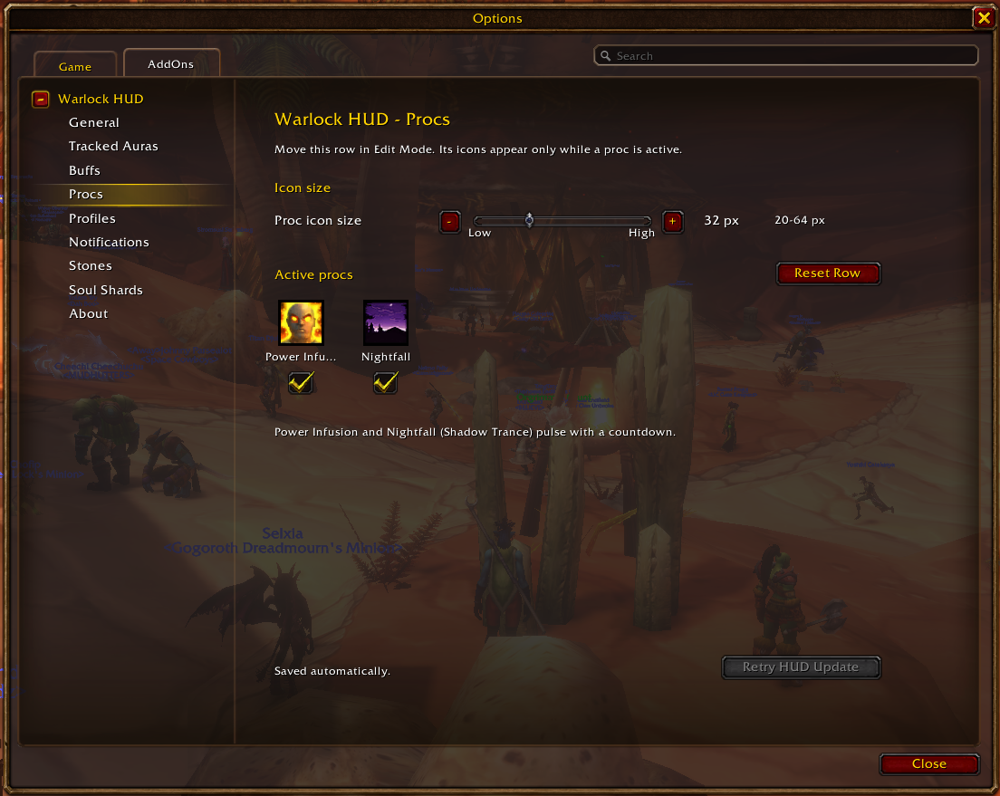

</details>

<details>
<summary>Profiles</summary>

Choose, copy, rename, or delete profiles, and optionally assign them to dual
specs. The summary shows enabled slots and row sizes.

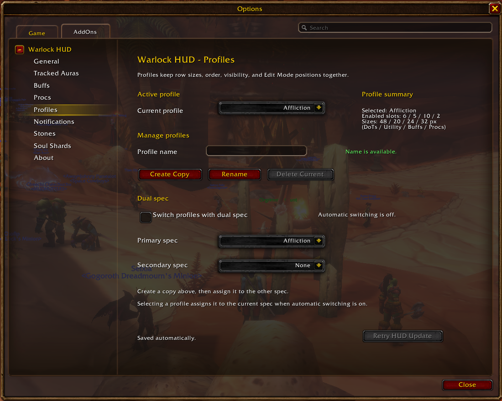

</details>

<details>
<summary>Notifications</summary>

Choose summon, Soulstone, and completed Healthstone trade notices and where
eligible notices are sent.

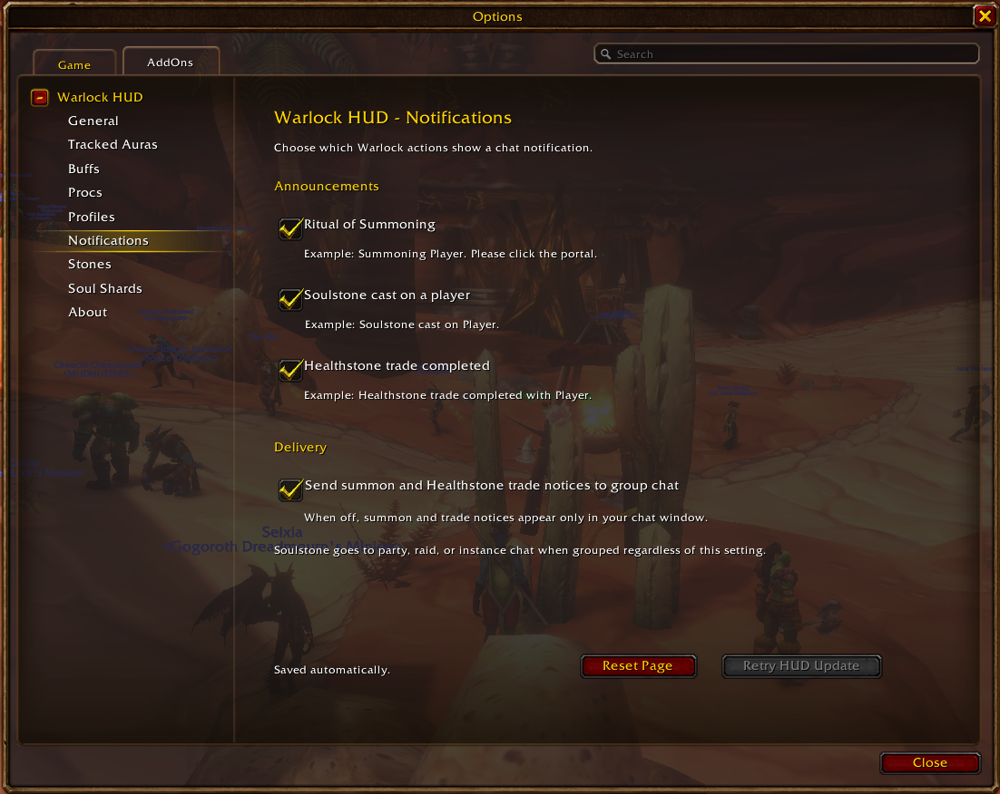

</details>

<details>
<summary>Summons</summary>

Set a comma-separated list of request keywords and accepted chat sources,
enable nearby removal, and open or preview the summon queue window.

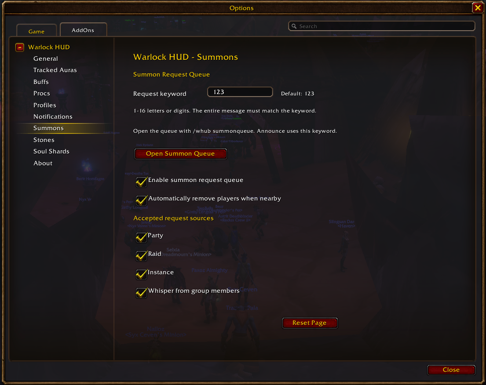

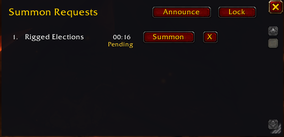

</details>

<details>
<summary>Stones</summary>

Configure the Soulstone tracker, Healthstone trade records, automatic placement
for group members, and the supplied-player list.

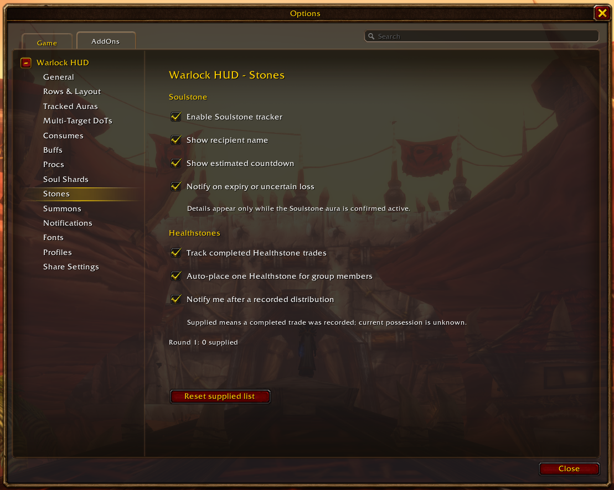

</details>

<details>
<summary>Soul Shards</summary>

Set the shard icon size, deletion reserve, red and yellow warning thresholds,
and optional Soul Bag overflow warning.

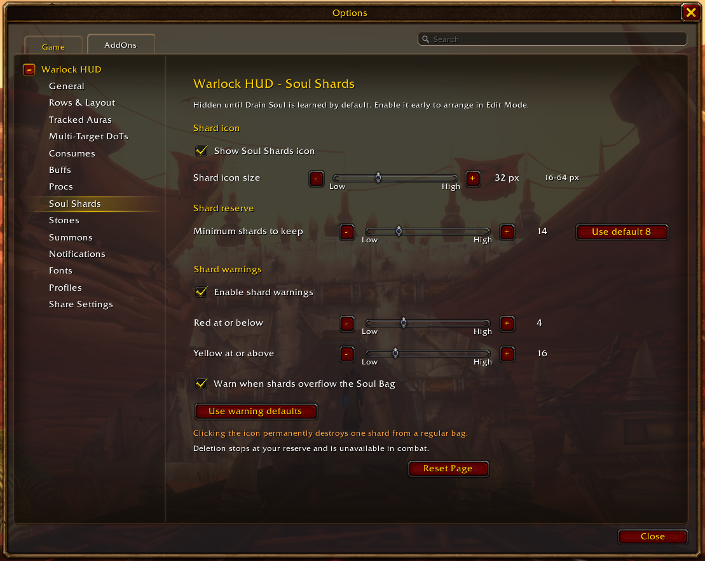

</details>

The addon prints its version and the settings command in chat when it loads.
For a one-time diagnostic snapshot, use `/whub debug`. It prints the active
profile, configured rows and tracked spell IDs, target/range status when safe,
and aura-tracker initialization without reading aura data.

## Development

The `.toc` file defines the addon version and Lua load order. Edit the Lua files
directly and use `/reload` in game to test changes. The game stores profiles in
`WarlockHudDB` as a SavedVariable.

### CurseForge releases

The tag workflow builds `Warlock_Hud-vX.Y.Z.zip`, publishes the GitHub Release,
then uploads that exact ZIP to CurseForge project `1727219` for Warcraft Forever
`1.60.1`. This keeps the filename and contents consistent across both sites.
The upload uses the matching file in `releases/` as its changelog, or
`CHANGELOG.md` if no release note exists.

Before publishing a new tag, create a CurseForge API token and store it in the
repository's GitHub Actions secret named `CF_API_TOKEN`. Disable the old
CurseForge packaging webhook in GitHub **Settings > Webhooks**; otherwise the
tag push can create a second CurseForge file before the workflow finishes.
Do not commit or share the token. The workflow fails visibly if the secret is
missing.

`.pkgmeta` remains available for repository packaging, but the GitHub Actions
upload uses the ZIP built by `.github/workflows/package.yml`.

To retry a release after a cancelled or failed tag run, open **Actions > Package
Warlock HUD > Run workflow** on `main` and enter the existing tag in
`release_tag`. The workflow checks out that tag, confirms its `.toc` version,
reuses an existing GitHub Release if present, and then uploads the ZIP to
CurseForge. Check CurseForge first so a retry does not create a duplicate file.

See [LICENSE](LICENSE) for the license.
